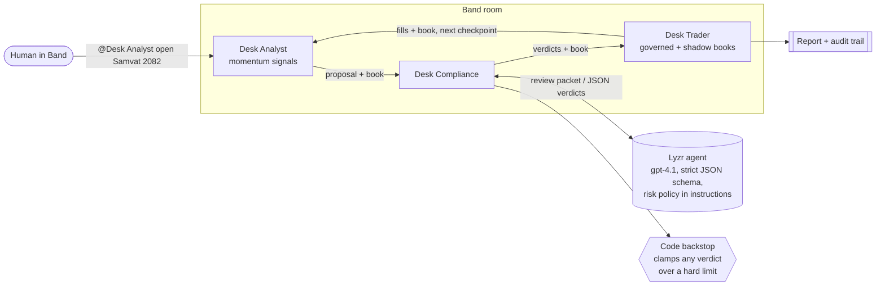

# Muhurat Desk

**A governed agent-to-agent trading desk.** An aggressive Analyst agent proposes trades, a Compliance agent built on **Lyzr** approves, resizes or vetoes each one against a written risk policy, and a Trader agent fills only what Compliance allowed. All three talk in a **Band** room, and everything they decide is recorded in an audit trail.

Built for the **Diwali Festiverse Agent-to-Agent Hackathon (India Edition)**, Finance track (Analyze & Trade).

> Educational paper trading on historical prices. Not investment advice.

## Why it matters

Diwali opens the Hindu financial new year with **Muhurat trading**, a one-hour NSE session that many first-time investors use to make a "lucky" first trade. Retail investors who trade on conviction alone tend to concentrate risk: SEBI's 2024 study found that 93% of individual F&O traders lost money between FY22 and FY24.

AI trading agents make this worse when nothing stands between the idea and the order. Muhurat Desk shows the other way to build them: **one agent has the idea, a different agent has the veto, and the code makes sure the veto cannot be talked around.**

## What happens

The desk replays **Samvat 2082**: Muhurat trading on 21 Oct 2025, then the first session of every month up to Muhurat 2083 (Nov 2026), with ₹10,00,000 of paper capital and 20 NSE large caps.

At each of the 14 checkpoints:

1. **Desk Analyst** ranks the universe by momentum using only data up to that day, sizes positions by conviction and proposes trades. It doesn't know the risk policy; it chases strength.
2. **Desk Compliance** computes the risk facts (weight after the trade, sector exposure, volatility, headroom under each rule) and sends them to the **Lyzr compliance agent**. Lyzr returns a structured verdict per order (`APPROVE` / `MODIFY` / `VETO`, rule ids and a plain-language reason). A code backstop then re-checks every verdict, so an LLM mistake can never put the book out of policy.
3. **Desk Trader** fills the approved quantities into the governed book and the analyst's raw proposal into an *unchecked* shadow book, so the desk can measure exactly what governance changed. At year end it posts the scorecard and writes an HTML report.

The whole conversation happens in one Band room. The agents share no database: the book itself travels in their messages.

## Results (Samvat 2082 replay)

| Book | Return | Max drawdown | Volatility | Final value |
|---|---|---|---|---|
| **Governed desk** (Analyst + Lyzr Compliance) | **−5.9%** | **−11.0%** | 9.0% | ₹9,40,071 |
| Unchecked analyst (same ideas, no compliance) | −15.6% | −27.1% | 18.5% | ₹8,43,319 |
| Nifty 50 | −3.2% | −15.6% | 14.1% | ₹9,67,596 |

Over 81 orders, Lyzr approved 46, resized 20 and vetoed 15. **Governance kept ₹96,752 that the unchecked analyst lost and cut the worst fall from a peak from 27% to 11%.** The momentum strategy itself didn't beat the index in a falling year, and the desk doesn't pretend it did: the point is that the same ideas, governed, lost far less.

Every number is reproducible: `uv run python scripts/replay_offline.py` replays the year from the frozen price file and the cached Lyzr verdicts, at zero API cost.

## Architecture



| Layer | Where | What it guarantees |
|---|---|---|
| Market data | `desk/market.py` | Point-in-time signals: a function given `asof` only reads rows up to it (tested). |
| Analyst | `desk/analyst.py` | Deliberately aggressive, so there is something to govern (tested: its raw targets break R1). |
| Compliance | `desk/compliance.py` | Risk facts → Lyzr verdict → backstop. Falls back to the same policy in code if Lyzr is unreachable. |
| Trader | `desk/trader.py` | Fills, costs (0.1%), governed and shadow books, scorecard. |
| Agents | `agents/*.py` | Band `SimpleAdapter`s. Each routes one stage; the logic lives in `desk/`. |
| Narration | `desk/narrate.py` | An LLM (local Ollama in development) writes the Analyst's two-sentence market note from numbers the code computed. A template takes over if the model is slow, so no decision depends on it. |

### The risk policy

Defined once in `desk/config.py` and sent to Lyzr verbatim:

- **R1** One stock ≤ 15% of NAV after the trade
- **R2** One sector ≤ 35% of NAV
- **R3** If annualised 20-day volatility > 40%, the position ≤ 7.5% of NAV
- **R4** Cash ≥ 5% of NAV
- **R5** No buying a holding that is more than 10% below its average cost
- **R6** Long only: no shorts, leverage or derivatives

## Sponsor stack

| Sponsor | How Muhurat Desk uses it |
|---|---|
| **Lyzr** | The compliance agent is a Lyzr Agent Studio agent (`scripts/setup_lyzr_agent.py`): role, goal and the full risk policy as instructions, `gpt-4.1` at temperature 0, and a strict JSON response schema. Every proposal goes through `/v3/inference/chat/`. Lyzr is the agent that says no, and its verdicts and reasons are what the Trader acts on and what the audit trail records. |
| **Band** | The three agents are Band agents in one room, and every handoff is a Band message with a mention. The desk state (proposal, verdicts, books) travels inside those messages, so Band is the only channel between them. |
| **AdaL** | The demo video was made with AdaL, as the rules ask. |

## Run it

Requirements: Python 3.12, [uv](https://docs.astral.sh/uv/), and for live narration [Ollama](https://ollama.com) with `gemma4:e4b` (optional).

```bash
uv sync

# 1. Replay the year in-process (no accounts needed)
uv run python scripts/replay_offline.py --local     # local policy engine only
uv run python scripts/replay_offline.py             # Lyzr verdicts (cached ones are free)

# 2. Tests
uv run --group dev python -m pytest -q
```

To run the live multi-agent desk on Band:

```bash
# Keys are read from files, never from the command line:
#   ~/.secrets/band.key  Band user API key
#   ~/.secrets/lyzr.key  Lyzr API key
uv run python scripts/register_band_agents.py   # writes agent_config.yaml (gitignored)
uv run python scripts/setup_lyzr_agent.py       # creates the Lyzr compliance agent
uv run python scripts/run_agents.py             # starts Analyst, Compliance, Trader
uv run python scripts/open_desk.py              # opens a Band room and runs the year
```

Then open the room in [app.band.ai](https://app.band.ai) to watch the agents argue, or open `output/runs/<run>/report.html` for the scorecard and audit trail.

Settings in `.env`: `LLM_BACKEND=ollama|gemini`, `OLLAMA_MODEL`, `GEMINI_MODEL`, `NARRATE=0` to skip narration, `LYZR_OFFLINE=1` to use cached verdicts only.

## Repository

```
desk/        the desk itself: config + policy, market data, analyst, compliance, trader, engine, report
agents/      the three Band agents (thin routers around desk/)
scripts/     register agents, set up Lyzr, run agents, open the desk, offline replay
data/        frozen Samvat 2082 prices, Lyzr agent id, cached Lyzr verdicts
tests/       offline tests: no lookahead, policy holds, backstop works, messages round-trip
```

## Problems we hit

- **The LLM resized too little or vetoed too much.** With `gpt-4o-mini` the Lyzr agent vetoed 22 orders that the policy said to resize, which made the governed book look better just by holding cash. Switching to `gpt-4.1` and giving it per-rule headroom brought that down to 1 in 81. The backstop still guarantees the hard limits whatever the model says.
- **A label could contradict the quantity** ("APPROVE" with a smaller size). The desk now derives the label from the quantity.
- **Small local models don't drive tool calls reliably.** The agents therefore make every decision in code and use the LLM only for prose. Band handoffs are deterministic.
- **Windows Application Control blocked some native wheels** (`xxhash` 4.x). The fix is pinning `xxhash==3.5.0`.

## Limits

Daily closes, not the intraday Muhurat session; fills at the checkpoint close; one strategy and one year. The policy is the desk's own, written in the spirit of retail investor-protection norms, and isn't a SEBI rulebook.

## License

MIT
