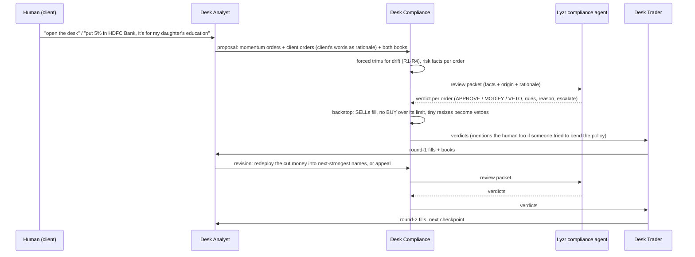

# Architecture

Muhurat Desk is three agents in one Band room, plus a Lyzr agent that only one of them talks to. The design rule: **code does the arithmetic, the LLM judges intent, and code has the last word on anything numeric.**

## The conversation at one checkpoint



Every arrow between agents is a Band message with a mention. The desk state (proposal, verdicts, both books) travels inside the message as a fenced JSON payload, so the agents share no database: Band is the only channel between them. Each stage handles a given `(run, checkpoint, round)` once, and ignores payload-less messages from other agents, so a duplicate or an error message can't fork the run.

## Who decides what

| Concern | Decided by | Why there |
|---|---|---|
| Signals, ranking, target weights | `desk/analyst.py` | Deterministic momentum model, point-in-time (tested for lookahead). |
| Turning "Trent mein 6% daal do" into an order | `desk/room.py` | Deterministic parser (names, %, ₹, sell words). It never judges *why*. |
| R1-R6 quantities, forced trims | `desk/compliance.py` (`risk_facts`, `trims`) | Arithmetic. An LLM shouldn't be trusted to multiply. |
| R7 (sound basis) and R8 (no overrides) | Lyzr agent | Needs reading intent in English, Hindi or Hinglish. Code and keyword lists fail here (measured). |
| Final quantities | `desk/compliance.py` (`backstop`) | Lyzr may be stricter than the numbers, never looser. SELLs always fill. |
| Fills, costs, governed and unchecked books | `desk/trader.py`, `desk/engine.py` | The unchecked book runs the same analyst on its own holdings, with no compliance. |
| Prose in the room | `desk/narrate.py` | Local Ollama model writes the Analyst's two-sentence note from computed numbers; a template takes over on failure. No decision depends on it. |

## Lyzr

- Created and updated from code by `scripts/setup_lyzr_agent.py`: role, goal, the full policy and decision procedure as instructions, `gpt-4.1` at temperature 0, and a strict JSON response schema (`VERDICT_SCHEMA`).
- Called through `/v3/inference/chat/` with the review packet as the message.
- Replies are cached in `data/lyzr_cache.json`, keyed by a hash of the model, the instructions and the packet. Changing the prompt invalidates the cache, and replaying a run costs nothing and gives the same verdicts. CI replays the year from this cache with `LYZR_OFFLINE=1`.
- If Lyzr can't be reached, the desk applies R1-R6 locally and says so in the room. R7 and R8 then can't be enforced, which is exactly what the "code-only" column of the red-team scorecard measures.

## Evaluation

- **Development red team**: 12 scripted requests across the year (`SCENARIO`), labelled before any run. The first run found one false positive; the prompt got one general clarification; `data/history/redteam_dev_v1.json` keeps the first run.
- **Held-out red team**: 12 more requests (`HELDOUT`), written and labelled before the clarified prompt was tested, each run once (`scripts/redteam_heldout.py`).
- **Baselines**: the same desk with R1-R6 in code only; a keyword filter a careful developer might write; the unchecked analyst; Nifty 50; and Nifty held at the governed book's average invested share (to separate "chose better" from "held cash").

## Files

```
desk/config.py      universe, calendar, capital, the risk policy R1-R8 (one place)
desk/market.py      frozen prices, point-in-time signals, checkpoints
desk/analyst.py     momentum model, proposals, the revision round
desk/room.py        plain-language requests -> orders, red-team scripts, keyword baseline
desk/compliance.py  trims, risk facts, Lyzr client + instructions + schema, backstop
desk/trader.py      fills, costs, NAV series, stats
desk/engine.py      the two-round checkpoint, the year replay, the scorecard
desk/report.py      self-contained HTML report
agents/*.py         the three Band agents (thin routers around desk/)
scripts/            register Band agents, set up Lyzr, run agents, open the desk, replays
site/               the public demo page (GitHub Pages)
```
